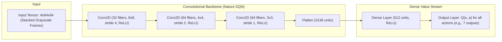
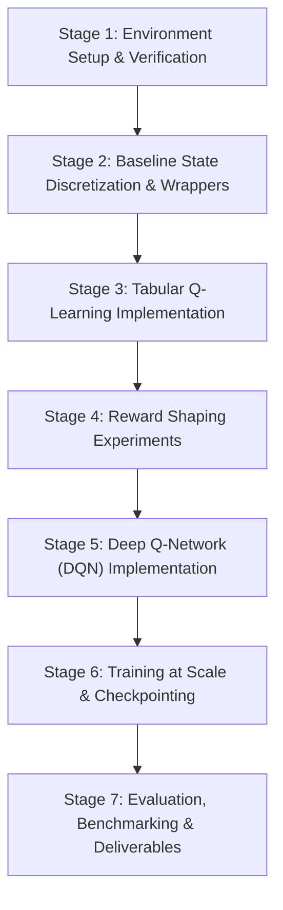

# 🍄 Reinforcement Learning Mario Agent: Architecture, Workflow & Technical Specification

> **Project Level**: Intermediate – Advanced  
> **Domain**: Machine Learning & Reinforcement Learning (RL)  
> **Application**: Autonomous 2D Mario Game Playing Agent  

---

## 1. Executive Summary & Project Objectives

The objective of this project is to develop an autonomous Reinforcement Learning (RL) agent capable of mastering a 2D Mario platformer environment through trial-and-error interaction rather than hardcoded heuristics. 

The agent observes environment states (e.g., Mario's coordinates, nearby obstacles, enemy distances, or screen pixels), chooses discrete actions (moving, jumping, accelerating), and updates its policy using reward feedback (progressing rightward, reaching the flag, collecting coins, avoiding enemies, and surviving).

This specification covers two sequential milestones:
1. **Milestone 1 (Foundational / Core Requirement)**: Discretized State-Space **Tabular Q-Learning** on a custom 2D Mario Gymnasium/Pygame environment.
2. **Milestone 2 (Advanced / Extension)**: **Deep Q-Networks (DQN / Double-DQN)** handling high-dimensional visual or continuous state inputs with Experience Replay and Target Networks.

---

## 2. High-Level System Architecture

The system follows the standard Markov Decision Process (MDP) loop augmented by custom wrappers for observation preprocessing, frame stacking, and reward shaping.

```mermaid
flowchart TD
    subgraph Environment ["2D Mario Environment (Gymnasium / Pygame)"]
        Physics["Game Physics Engine (Pygame / NES)"]
        RawState["Raw State (Coordinates / Frame Pixels)"]
        Physics --> RawState
    end

    subgraph Preprocessing ["Observation & Reward Wrappers"]
        Discretizer["State Discretizer (For Tabular Q)"]
        FrameStack["Grayscale + Resize (84x84) + 4-Frame Stack (For DQN)"]
        RewardShaper["Reward Function & Normalizer"]
        RawState --> Discretizer
        RawState --> FrameStack
        RawState --> RewardShaper
    end

    subgraph Agent ["RL Agent Core"]
        Policy["Epsilon-Greedy Action Selector"]
        
        subgraph Tabular ["Milestone 1: Q-Learning"]
            QTable["Q-Table: S x A -> R"]
        end
        
        subgraph DeepRL ["Milestone 2: DQN Extension"]
            OnlineNet["Q-Network (CNN / MLP)"]
            TargetNet["Target Q-Network"]
            ReplayBuffer["Experience Replay Buffer"]
        end
    end

    Discretizer -->|Discretized State S_t| QTable
    FrameStack -->|Observation Tensor s_t| OnlineNet
    RewardShaper -->|Reward r_t, Done| Agent

    QTable --> Policy
    OnlineNet --> Policy

    Policy -->|Action a_t| Physics
    Agent -->|Store (s, a, r, s', done)| ReplayBuffer
    ReplayBuffer -->|Minibatch Sampling| OnlineNet
    OnlineNet -.->|Periodic Weight Sync| TargetNet
```

---

## 3. Environment & State-Action Representation

### 3.1 Environment Selection Options
Depending on computing resources and scope, two environment approaches can be chosen:

1. **Option A (Custom Lightweight Pygame 2D Mario)**:
   - *Pros*: Complete control over state variables, zero external emulation dependencies, runs extremely fast in headless mode (hundreds of FPS), ideal for Tabular Q-learning.
   - *Physics*: Bounding-box collisions, gravity, jump impulse, forward velocity, enemy patrol logic.
2. **Option B (`gym-super-mario-bros` / NES Emulator)**:
   - *Pros*: Authentic Super Mario Bros (NES World 1-1 to 1-4).
   - *Cons*: Needs visual wrappers and Deep RL (DQN) as tabular state space is infinite without manual coordinate extraction via RAM hacking.

---

### 3.2 Action Space ($A$)
Mario requires discrete control combinations. Restricting unnecessary actions reduces the branching factor and accelerates convergence.

| Action ID | Name | Keys / Inputs | Description |
|:---|:---|:---|:---|
| `0` | **NOOP** | None | Stand still / Idle |
| `1` | **Right** | `RIGHT` | Walk right |
| `2` | **Right + Jump** | `RIGHT + A` | Running jump over gaps/enemies |
| `3` | **Right + Speed**| `RIGHT + B` | Sprint right |
| `4` | **Right + Speed + Jump** | `RIGHT + B + A` | Long running jump |
| `5` | **Jump** | `A` | Jump vertically in place |
| `6` | **Left** | `LEFT` | Walk left (retreat / reposition) |

---

### 3.3 State Representation ($S$)

#### A. For Tabular Q-Learning (Milestone 1)
To prevent combinatorial explosion ($|\mathcal{S}| \to \infty$), the continuous coordinates must be quantized into discrete feature buckets:

$$\mathcal{S} = \langle X_{rel\_grid}, Y_{grid}, V_y, InAir, ObstacleAhead, PitAhead, EnemyNearby \rangle$$

- **$X_{progress}$ / Grid Offset**: Segment index of the level (e.g., $16 \times 16$ tile bucket).
- **$Y_{grid}$**: Discretized vertical height level ($0$ to $10$).
- **$V_y$**: Vertical velocity sign (`-1`: falling, `0`: flat, `1`: rising).
- **$ObstacleAhead$**: Binary flag ($1$ if a pipe or block is $1\text{--}2$ tiles directly in front).
- **$PitAhead$**: Binary flag ($1$ if ground tile ahead is missing / bottomless pit).
- **$EnemyNearby$**: Discretized vector indicating distance and quadrant of the nearest Goomba/Koopa ($[-1, 0, 1]$ relative $X$, $Y$).

> **State Space Size**: Constrained to $\approx 5,000 - 20,000$ unique states, easily fitting in memory.

#### B. For Deep Q-Network (Milestone 2)
- **Input Observation**: Grayscale $84 \times 84 \times 4$ tensor.
- **Frame Stacking**: 4 consecutive frames stacked along the channel axis. This resolves the partial observability of velocity and trajectory (i.e., whether Mario or an enemy is moving left or right).

---

## 4. Reward Engineering & Shaping

Reward design is critical: naive sparse rewards (reward only upon reaching the flagpole) lead to sample inefficiency and stagnation.

### 4.1 Reward Formulation
For transition $(s_t, a_t, s_{t+1})$, the total reward $R_t$ is:

$$R_t = R_{progress} + R_{speed} + R_{event} + R_{penalty}$$

Where:

| Component | Formula / Condition | Value Range | Objective |
|:---|:---|:---|:---|
| **Horizontal Progress** | $c_1 \times (x_{t+1} - x_t)$ | $+1.0 \text{ to } +5.0$ per unit moved right | Incentivizes moving towards the finish line |
| **Backward Penalty** | If $(x_{t+1} - x_t) < 0$ | $-1.5 \times |x_{t+1} - x_t|$ | Discourages backtracking or retreating unnecessarily |
| **Idle / Time Penalty** | Constant deduction per frame | $-0.1 \text{ to } -0.05$ | Penalizes standing still, encouraging completion speed |
| **Coin Collection** | On coin pickup | $+10.0$ | Secondary reward for collecting resources |
| **Enemy Stomp** | On enemy eliminated | $+15.0$ | Encourages offensive/clearing maneuvers |
| **Damage / Death** | Falling down pit or hitting enemy | $-50.0 \text{ to } -100.0$ | Severe penalty to promote safety |
| **Stage Clear** | Reaching the flagpole / end | $+500.0$ | Primary task completion signal |

> [!WARNING]
> **Avoid Reward Hacking**:
> If the reward for jumping or stomping an enemy is too high compared to forward progress, the agent may learn to loop or jump repeatedly in place. Keep the forward distance weight dominant.

---

## 5. Learning Algorithms & Mathematical Foundations

### 5.1 Tabular Q-Learning (Milestone 1)
Q-learning is an off-policy Temporal Difference (TD) control algorithm updating the action-value function $Q(s, a)$:

$$Q(s_t, a_t) \leftarrow Q(s_t, a_t) + \alpha \left[ r_{t+1} + \gamma \max_{a'} Q(s_{t+1}, a') - Q(s_t, a_t) \right]$$

- **$\alpha \in (0, 1]$**: Learning rate (e.g., $0.1$).
- **$\gamma \in [0, 1)$**: Discount factor for future rewards (e.g., $0.95 - 0.99$).
- **Exploration Strategy ($\epsilon$-greedy)**:
  $$a_t = \begin{cases} \text{random action from } A, & \text{with probability } \epsilon \\ \arg\max_{a} Q(s_t, a), & \text{with probability } 1 - \epsilon \end{cases}$$
  $\epsilon$ decays exponentially: $\epsilon_{k+1} = \max(\epsilon_{min}, \epsilon_k \cdot \epsilon_{decay})$.

---

### 5.2 Deep Q-Network (DQN) Architecture (Milestone 2)



#### Key Enhancements for Training Stability:
1. **Experience Replay Buffer $\mathcal{D}$**:
   - Stores tuples $(s_t, a_t, r_t, s_{t+1}, \text{done})$.
   - Breaks temporal correlation by sampling minibatches uniformly at random.
2. **Target Network ($\theta^-$)**:
   - Separate network with frozen weights updated every $C$ steps ($\theta^- \leftarrow \theta$) to avoid moving-target instability:
   $$\mathcal{L}(\theta) = \mathbb{E}_{(s, a, r, s')} \left[ \left( r + \gamma \max_{a'} Q(s', a'; \theta^-) - Q(s, a; \theta) \right)^2 \right]$$
3. **Double DQN (DDQN)** (Optional recommended extension):
   - Mitigates Q-value overestimation by decoupling action selection from action evaluation:
   $$Y^{DoubleQ} = r + \gamma Q\left(s', \arg\max_{a} Q(s', a; \theta); \theta^-\right)$$

---

## 6. End-to-End Project Workflow



### Stage 1: Environment Setup & Verification
- Choose engine: Custom Pygame Mario or `gym-super-mario-bros`.
- Verify headless rendering and stepped simulation ($env.step(action)$).
- Verify standard reset and termination conditions (timeout, pit death, enemy touch, flagpole reach).

### Stage 2: Wrappers & Preprocessing
- Implement custom Gymnasium `ObservationWrapper` and `RewardWrapper`.
- Implement `SkipFrame` (repeat action for 4 ticks to reduce compute and match human reaction speed).
- For Tabular: write grid-bucket mapping function `discretize_state(raw_obs)`.
- For DQN: grayscale conversion, resizing to $84 \times 84$, frame stacking.

### Stage 3: Tabular Q-Learning Development
- Build `QTableAgent` class using Python `dict` or NumPy array:
  - Methods: `choose_action(state)`, `update(state, action, reward, next_state, done)`, `save_qtable()`, `load_qtable()`.
- Run sanity training on a simplified level (short flat track with 1 obstacle).

### Stage 4: Reward Shaping & Parameter Sweeps
- Compare:
  - Pure distance reward vs. Distance + Time penalty vs. Distance + Coin/Enemy bonuses.
- Tune hyperparameters:
  - $\alpha$: $0.05 \text{ to } 0.2$
  - $\gamma$: $0.95 \text{ to } 0.99$
  - $\epsilon_{start} = 1.0, \epsilon_{min} = 0.05, \text{decay} = 0.9995$

### Stage 5: Deep Q-Network (DQN) Development
- Build PyTorch / TensorFlow CNN model matching Nature DQN.
- Build cyclic `ReplayBuffer` (capacity: $50,000 - 100,000$ transitions).
- Implement training step using Adam optimizer, gradient clipping, and Huber Loss / Smooth L1 Loss.

### Stage 6: Scaled Training & Telemetry
- Run 1,000–5,000 episodes for Tabular Q; 500,000–2,000,000 steps for DQN.
- Log metrics to TensorBoard or CSV:
  - Episodic Total Reward
  - Max X-Coordinate achieved
  - Loss curve
  - Epsilon decay progression
  - Win/Clear rate (rolling average of last 100 episodes)

### Stage 7: Evaluation, Comparison & Visualization
- Test agents in evaluation mode ($\epsilon = 0$, pure greedy policy).
- Compare Untrained (Random) vs. Tabular Q-Agent vs. DQN Agent.
- Record playthrough GIFs/MP4 videos and plot performance charts.

---

## 7. Hyperparameter Reference Table

| Hyperparameter | Tabular Q-Learning | Deep Q-Network (DQN) | Purpose |
|:---|:---|:---|:---|
| **Learning Rate ($\alpha$)** | `0.1` | `1e-4` (Adam) | Step size for weight / Q-value updates |
| **Discount Factor ($\gamma$)** | `0.99` | `0.99` | Weight given to future rewards |
| **Initial $\epsilon$** | `1.0` | `1.0` | Initial random exploration probability |
| **Final $\epsilon$ ($\epsilon_{min}$)** | `0.05` | `0.02` | Minimum floor for exploration |
| **$\epsilon$ Decay** | `0.999` (per episode) | Linear over 500k steps | Rate of shifting from exploration to exploitation |
| **Replay Buffer Size** | N/A | `100,000` | Past experience pool capacity |
| **Batch Size** | N/A | `32` or `64` | Samples drawn per gradient step |
| **Target Update Period** | N/A | `1,000 - 2,000` steps | How often target network weights sync |
| **Frame Skip** | 4 | 4 | Number of game ticks action is held |
| **Frame Stack** | N/A | 4 frames ($84 \times 84$) | Temporal visual context |

---

## 8. Suggested Project Directory Structure

```text
mario-rl-agent/
├── README.md                           # Overview, setup, and run instructions
├── MARIO_RL_ARCHITECTURE_AND_WORKFLOW.md# This comprehensive design document
├── requirements.txt                    # Python dependencies
├── env/
│   ├── __init__.py
│   ├── custom_mario_env.py             # Pygame 2D Mario environment (if custom)
│   ├── nes_wrappers.py                 # Observation/Reward wrappers for gym-super-mario-bros
│   └── state_discretizer.py            # State quantizer for Tabular Q-learning
├── agents/
│   ├── __init__.py
│   ├── base_agent.py                   # Abstract Agent interface
│   ├── q_learning_agent.py             # Tabular Q-Learning implementation
│   └── dqn_agent.py                    # Deep Q-Network (PyTorch) implementation
├── models/
│   └── cnn_q_network.py                # PyTorch ConvNet architecture
├── utils/
│   ├── replay_buffer.py                # Replay Memory buffer
│   ├── logger.py                       # TensorBoard / CSV metrics logger
│   └── plotter.py                      # Matplotlib training visualization graphs
├── train_tabular.py                    # Training entry point for Tabular Q-Learning
├── train_dqn.py                        # Training entry point for DQN
├── evaluate.py                         # Evaluation & video recording script
├── checkpoints/                        # Saved Q-tables (.npy/.json) and PyTorch models (.pt)
└── logs/                               # TensorBoard event files and training plots
```

---

## 9. Evaluation Metrics & Deliverable Checklist

### Key Metrics to Track
1. **Average Cumulative Reward**: Increasing moving average over 100 episodes.
2. **Completion Rate (%)**: Percentage of episodes reaching the flagpole.
3. **Max Distance Reached ($X_{max}$)**: Maximum horizontal coordinate traversed before death or timeout.
4. **Time to Clear**: Game steps / seconds needed to reach the end.
5. **Death Distribution**: Heatmap or histogram of coordinate locations where Mario most frequently dies (used to identify challenging bottlenecks like deep pits or enemy clusters).

### Deliverables Checklist
- [x] **Playable Environment**: Fully functional 2D Mario simulator with keyboard play mode and RL step API.
- [x] **Tabular Q-Learning Implementation**: State discretizer, Q-table update logic, epsilon decay scheduler.
- [x] **Deep Q-Network Implementation (Extension)**: PyTorch DQN with Replay Buffer and Target Network.
- [x] **Visual Training Curve Graphs**:
  - Reward per Episode vs. Episode Number.
  - Loss vs. Training Steps.
  - Max $X$ Distance vs. Episodes.
- [x] **Recorded Playback Video**: Visual proof of the trained Mario agent running through the stage autonomously.
- [x] **Technical Report**: Documenting reward design experiments, hyperparameter tuning insights, and failure case analyses.
