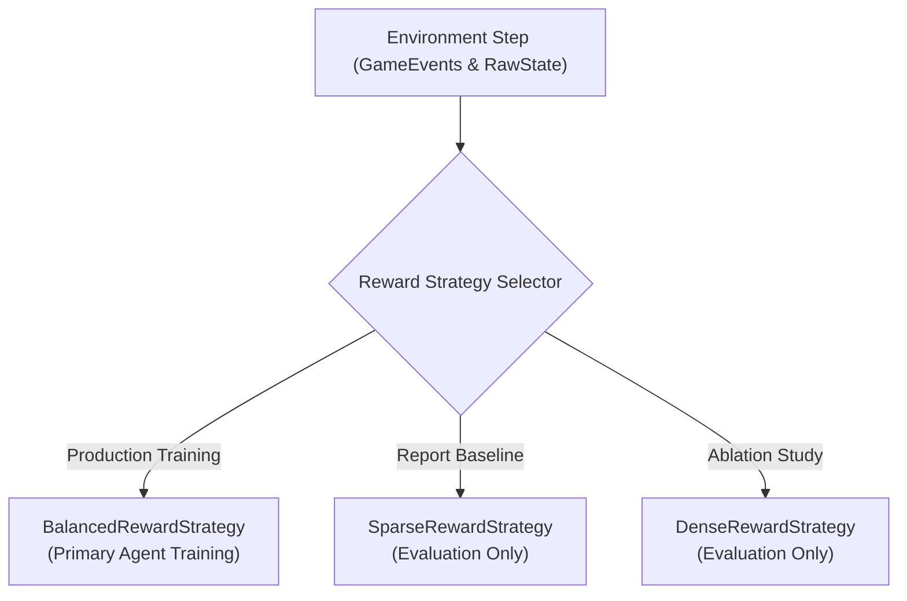

# Reinforcement Learning Mario Agent: Subsystem Architecture & Theoretical Design

This document details the mathematical formulations, system logic, and architectural designs for the **State Discretizer**, **Reward Strategies**, **Tabular Q-Learning Agent**, and **Core Interfaces** in the 2D Mario Reinforcement Learning platform.

---

> [!IMPORTANT]
> **Production Reward Policy Notification**:  
> **`BalancedRewardStrategy` is the sole reward strategy utilized for standard agent training.**  
> The remaining strategies (`SparseRewardStrategy` and `DenseRewardStrategy`) are maintained strictly as experimental baselines for comparative evaluation, ablation studies, and metrics reporting.

---

## 1. Architectural Foundations: `core/interfaces.py`

To satisfy **SOLID architecture**, each subsystem is decoupled via explicit abstract interfaces in `core/interfaces.py`. This ensures that changes to game physics (Member 1) or training harnesses (Member 3) do not propagate bugs into the agent or discretizer.

### 1.1 `DiscreteState` (Type Alias)
* **Definition**: `Tuple[int, int, int, int, int]`
* **Purpose**: Represents the quantized, hashable state vector indexing the agent's $Q$-table.

### 1.2 `BaseDiscretizer` (Abstract Base Class)
* **Core Contract**: `discretize(raw_state: RawState) -> DiscreteState`
* **Role**: Enforces the **Single Responsibility Principle (SRP)**. It isolates coordinate transformation and spatial bucketing from game physics and RL decision-making. 
* **Benefits**: If the level designer modifies the coordinate system or adds new sensors, only the discretizer implementation changes; the agent's logic remains intact.

### 1.3 `BaseRewardStrategy` (Abstract Base Class)
* **Core Contract**: `calculate_reward(prev_state, action, next_state, events, done) -> float`
* **Role**: Implements the **Strategy Pattern** (**Open/Closed Principle** & **Liskov Substitution Principle**). It allows seamless plug-and-play swapping between sparse, dense, and balanced feedback signals without changing the environment step logic or the agent update code.

### 1.4 `BaseAgent` (Abstract Base Class)
* **Core Contracts**:
  * `select_action(state: DiscreteState) -> int`: Policy inference.
  * `update(state, action, reward, next_state, done) -> float`: Bellman value updates.
  * `save(filepath: str) -> None` / `load(filepath: str) -> None`: Checkpointing and serialization.
  * `decay_epsilon() -> float`: Decrements exploration rate $\epsilon$.
  * `set_mode(training: bool) -> None`: Toggles training mode (exploration active) vs evaluation mode (pure greedy).
* **Role**: Decouples policy execution from the training loop. Evaluation scripts and real-time visualization tools depend strictly on this abstraction (**Dependency Inversion Principle**).

---

## 2. State Discretization Logic (`discretizer/state_discretizer.py`)

### 2.1 The Curse of Dimensionality & Spatial Invariance
In a continuous 2D platformer, Mario's position is governed by real-valued coordinates:

$$(x, y) \in \mathbb{R}^2, \quad (v_x, v_y) \in \mathbb{R}^2$$

Directly indexing a lookup table with floating-point values leads to an infinite state space ($|\mathcal{S}| \to \infty$) and total failure of generalization: the agent treats $x = 100.001$ as completely distinct from $x = 100.002$.

Furthermore, using **absolute global coordinates** ($x_{\text{world}}$) destroys level-to-level generalization. The `MarioStateDiscretizer` discards absolute coordinates in favor of **relative hazard proximity features**.

### 2.2 Feature Representation (The 5-Tuple)
Every continuous `RawState` is projected into a compact, discrete 5-tuple:

$$\mathcal{S} = \langle \text{is\_grounded}, \; V_{y\text{-sign}}, \; \text{Obstacle}_{\text{dist}}, \; \text{Obstacle}_{\text{height}}, \; \text{Pit}_{\text{dist}} \rangle$$

| Feature | Type / Range | Partition Logic & Thresholds | Physical & Navigational Meaning |
| :--- | :--- | :--- | :--- |
| **`is_grounded`** | `0` or `1` | `1 if raw_state.is_grounded else 0` | Informs the agent if a jump can be initiated, preventing invalid mid-air jump attempts. |
| **`vy_sign`** | `-1, 0, 1` | `1` if $v_y < -0.1$ (ascending jump in Pygame coordinates)<br>`-1` if $v_y > 0.1$ (falling downwards)<br>`0` otherwise (flat / grounded) | Distinguishes upward jump trajectory from downward descent. |
| **`obstacle_dist`** | `0, 1, 2, 3` | `0`: `NONE` ($> 80\text{ px}$, $< 0\text{ px}$, or obstacle already cleared vertically)<br>`1`: `FAR` ($40\text{--}80\text{ px}$)<br>`2`: `CLOSE` ($15\text{--}40\text{ px}$)<br>`3`: `IMMEDIATE` ($\le 15\text{ px}$) | Resolves **perceptual aliasing**. If Mario's feet are at or above the obstacle top ($\text{feet} \le 320 - h + 2\text{px}$), the obstacle is treated as cleared (`0 = NONE`). |
| **`obstacle_height`** | `0` or `1` | `0`: `LOW / NONE` ($\le 50\text{ px}$ or cleared)<br>`1`: `HIGH` ($> 50\text{ px}$) | Calibrated for level heights ($44\text{--}68\text{ px}$): $44\text{--}48\text{ px}$ pipes are `0 = Low`, while $56\text{--}68\text{ px}$ pipes are `1 = High`. |
| **`pit_dist`** | `0, 1, 2` | `0`: `NONE` ($> 80\text{ px}$ or $< 0\text{ px}$ / no pit)<br>`1`: `FAR` ($32\text{--}80\text{ px}$, approach zone)<br>`2`: `IMMEDIATE` ($\le 32\text{ px}$, safe take-off zone) | Calibrated for $65\text{--}75\text{ px}$ wide pits to ensure Mario initiates jumps within the safe take-off window without falling short. |


### 2.3 State Space Cardinality Calculation

$$|\mathcal{S}| = 2 \times 3 \times 4 \times 2 \times 3 = 144 \text{ discrete states}$$

* **Why 144 is optimal**: A state space of 144 entries is sufficiently small that a tabular agent visits high-frequency states hundreds of times within 300–500 episodes, ensuring fast asymptotic convergence without deep neural networks.

---

## 3. Reward Configurations & Shaping Logic (`rewards/`)

The reward function translates raw physical events emitted by the game engine into scalar reinforcement signals $r_{t+1}$.

### 3.1 Overview of the 3 Implemented Strategies



---

### 3.2 Strategy 1: `BalancedRewardStrategy` (PRIMARY PRODUCTION STRATEGY)

> [!NOTE]
> This is the **default and only** reward strategy utilized during actual agent training runs.

#### Mathematical Formulation

$$r_{t+1} = r_{\text{progress}}(\Delta x) + r_{\text{goal}} \cdot \mathbb{I}_{\text{reached\_goal}} + r_{\text{pit}} \cdot \mathbb{I}_{\text{fell\_in\_pit}} + r_{\text{obstacle}} \cdot \mathbb{I}_{\text{hit\_obstacle}} + r_{\text{step}}$$

#### Key Architectural Features:
1. **Asymmetric Horizontal Progress ($r_{\text{progress}}$)**:
   $$r_{\text{progress}}(\Delta x) = \begin{cases} w_{\text{progress}} \cdot \Delta x = 1.0 \cdot \Delta x, & \text{if } \Delta x > 0 \\ w_{\text{regress}} \cdot \Delta x = 1.5 \cdot \Delta x, & \text{if } \Delta x \le 0 \end{cases}$$
   * **Problem solved**: In symmetric systems ($+1.0$ forward, $-1.0$ backward), agents can oscillate back-and-forth without penalty. Asymmetric regression penalty ($1.5 \times$) makes retreating mathematically unprofitable.
2. **Terminal Goal Bonus ($r_{\text{goal}} = +200.0$)**:
   Establishes a high-value global attractor that anchors the Bellman backups across preceding states.
3. **Pit Fall Penalty ($r_{\text{pit}} = -75.0$)**:
   Severely punishes falling into voids, driving negative value propagation back into the pre-pit jump states.
4. **Obstacle Collision Penalty ($r_{\text{obstacle}} = -3.0$)**:
   Teaches the agent that running into the side of a pipe delays forward progress compared to clearing it via a jump.
5. **Living Cost ($r_{\text{step}} = -0.1$)**:
   Applies a minor penalty every tick, deterring hesitation, standing still (`Action.STAY`), or excessive stalling.

---

### 3.3 Strategy 2: `SparseRewardStrategy` (Evaluation Baseline)

* **Formulation**:
  $$r_{t+1} = \begin{cases} +100.0, & \text{if reached\_goal} \\ -50.0, & \text{if fell\_in\_pit} \\ 0.0, & \text{otherwise} \end{cases}$$
* **Purpose**: Serves as the unshaped RL theoretical benchmark.
* **Characteristics**: Zero risk of reward hacking, but suffers from the **Credit Assignment Problem**. Mario receives no guidance during mid-level traversal, making learning extremely slow.

---

### 3.4 Strategy 3: `DenseRewardStrategy` (Evaluation Ablation)

* **Formulation**:
  $$r_{t+1} = 1.2 \cdot (\text{dist\_to\_goal}_{t} - \text{dist\_to\_goal}_{t+1}) + r_{\text{terminal}} + r_{\text{idle}}$$
* **Purpose**: Tests aggressive continuous shaping based on Euclidean distance reduction to the flagpole.
* **Characteristics**: Produces fast initial forward movement, but can cause greedy local traps (e.g., Mario rushes directly toward obstacles rather than timing jumps early).

---

## 4. Tabular Q-Learning Agent (`agent/tabular_q_agent.py`)

The agent implements an off-policy model-free Temporal Difference control algorithm with state-action mapping:

$$Q: \mathcal{S} \times \mathcal{A} \to \mathbb{R}$$

### 4.1 Action Space ($\mathcal{A}$)
The agent outputs discrete actions defined by `core.Action`:
* `0 (STAY)`: Decelerate or remain stationary.
* `1 (LEFT)`: Move leftward (repositioning).
* `2 (JUMP)`: Vertical jump without forward momentum.
* `3 (RIGHT)`: Move rightward toward the goal.
* `4 (RIGHT_JUMP)`: Forward jump used to clear pipes and pits.

### 4.2 Action Selection & Deterministic Tie-Breaking
During action selection, the agent balances exploration and exploitation using an $\epsilon$-greedy policy:

$$\pi(a \mid s) = \begin{cases} \text{UniformRandom}(\mathcal{A}), & \text{with probability } \epsilon \\ \arg\max_{a'} Q(s, a'), & \text{with probability } 1 - \epsilon \end{cases}$$

#### Deterministic Random Tie-Breaking
At initialization, all $Q(s, a) = 0.0$. Standard Python `argmax()` default-selects the first index (`Action.STAY`), creating severe initialization bias.  
The agent instead identifies all maximal action candidates and samples uniformly:

```python
q_values = self.q_table[state]
max_val = np.max(q_values)
candidates = np.flatnonzero(q_values == max_val)
return int(np.random.choice(candidates))
```

### 4.3 Temporal Difference Control Update (Q-Update)
Upon executing action $a_t$ in state $s_t$, receiving reward $r_{t+1}$, and observing next state $s_{t+1}$:

$$Q(s_t, a_t) \leftarrow Q(s_t, a_t) + \alpha \cdot \delta_t$$

Where the **TD Error ($\delta_t$)** is:

$$\delta_t = \text{TD Target} - Q(s_t, a_t)$$

$$\text{TD Target} = \begin{cases} r_{t+1}, & \text{if } s_{t+1} \text{ is terminal (win or death)} \\ r_{t+1} + \gamma \max_{a'} Q(s_{t+1}, a'), & \text{if } s_{t+1} \text{ is non-terminal} \end{cases}$$

* **$\alpha = 0.1$ (Learning Rate)**: Controls how aggressively new experience replaces historical estimates.
* **$\gamma = 0.99$ (Discount Factor)**: Weights future rewards relative to immediate feedback.

### 4.4 Exploration Decay ($\epsilon$-Decay)
Exploration decreases monotonically after each episode:

$$\epsilon_{k+1} = \max(\epsilon_{\min}, \; \epsilon_k \cdot \lambda_{\text{decay}})$$

* Default hyperparameters: $\epsilon_0 = 1.0$, $\lambda_{\text{decay}} = 0.995$, $\epsilon_{\min} = 0.01$.

### 4.5 Dual-Mode Operation
* **Training Mode (`set_mode(True)`)**: Enables $\epsilon$-greedy exploration to discover optimal policies.
* **Evaluation Mode (`set_mode(False)`)**: Fixes $\epsilon = 0.0$, enforcing deterministic exploitation of the optimal policy.

### 4.6 Persistence (`save` and `load`)
* Serializes the internal $Q$-table and hyperparameter configuration to disk.
* Supports both binary Pickle (`.pkl`) for rapid checkpointing and human-readable JSON (`.json`) for report analysis.
* Preserves trained policies across game restarts and facilitates offline evaluation by Member 4 without retraining.

---

## 5. Requirements & Integration Guide for Member 3 (Training Step)

This section defines the explicit operational requirements for **Member 3 (Reward & Training)** when orchestrating the training loop with `TabularQAgent`.

### 5.1 Subsystem Initialization Contract
Member 3 must instantiate the components using the agreed interfaces:

```python
from env import create_env
from discretizer.state_discretizer import MarioStateDiscretizer
from rewards.balanced_reward import BalancedRewardStrategy
from agent.tabular_q_agent import TabularQAgent

# 1. Environment & Subsystem Setup
env = create_env(level_id=1)
discretizer = MarioStateDiscretizer()
reward_strategy = BalancedRewardStrategy()  # Mandatory production strategy
agent = TabularQAgent(
    learning_rate=0.1,
    discount_factor=0.99,
    epsilon=1.0,
    epsilon_min=0.01,
    epsilon_decay=0.995,
    training=True,
)
```

### 5.2 Step Loop Execution Contract
During each step of an episode, Member 3 must execute the following perception-action-learning sequence:

1. **State Discretization**: Convert `RawState` to `DiscreteState`:
   ```python
   discrete_state = discretizer.discretize(raw_state)
   ```
2. **Action Selection**: Query the agent:
   ```python
   action = agent.select_action(discrete_state)
   ```
3. **Environment Physics Step**:
   ```python
   next_raw_state, events, done = env.step(action)
   next_discrete_state = discretizer.discretize(next_raw_state)
   ```
4. **Reward Evaluation**:
   ```python
   reward = reward_strategy.calculate_reward(raw_state, action, next_raw_state, events, done)
   ```
5. **In-Memory Bellman Update**:
   ```python
   agent.update(discrete_state, action, reward, next_discrete_state, done)
   ```
   *(Note: This update operates entirely in RAM within microseconds. Do **not** call file saving here).*
6. **Advance State**:
   ```python
   raw_state = next_raw_state
   discrete_state = next_discrete_state
   ```

### 5.3 Episode Completion Contract
At the end of every episode:
1. **Decay Exploration**: Member 3 must decay $\epsilon$ once per episode:
   ```python
   current_epsilon = agent.decay_epsilon()
   ```

### 5.4 Q-Table Storage & Checkpoint Requirements

> [!CAUTION]
> **Performance Warning**:  
> Never save the Q-table inside the per-step loop (`env.step`). Disk operations will degrade training throughput from >1,000 FPS to under 30 FPS. All learning updates occur in RAM.

Member 3 is required to persist the learned Q-table according to the following storage rules:

#### 1. Best-Model Checkpointing (`.pkl`)
Save the Q-table whenever the current episode achieves a new highest total reward:
```python
if episode_reward > best_reward:
    best_reward = episode_reward
    agent.save("checkpoints/q_table_best.pkl")
```

#### 2. Periodic Checkpointing (`.pkl`)
Save every $N$ episodes (e.g., every 50 or 100 episodes) so training can resume if interrupted:
```python
if episode % 50 == 0:
    agent.save(f"checkpoints/q_table_ep{episode}.pkl")
```

#### 3. Mandatory Final Delivery for Member 4 (`.pkl` and `.json`)
Upon completion of training, Member 3 **must export two files** to the `checkpoints/` directory:

1. **`checkpoints/q_table_final.pkl`**:
   * Required by **Member 4 (Evaluation)** to run headless evaluation benchmarks and launch the visual Pygame demo at $\epsilon = 0$.
2. **`checkpoints/q_table_final.json`**:
   * Required by **Member 4** for data inspection, state-space coverage analysis ($|\mathcal{S}_{\text{visited}}| / 144$), and table visualization in the final technical report.

```python
# At the end of train.py:
agent.save("checkpoints/q_table_final.pkl")
agent.save("checkpoints/q_table_final.json")
print("[Training] Delivered final .pkl and .json checkpoints to checkpoints/")
```

