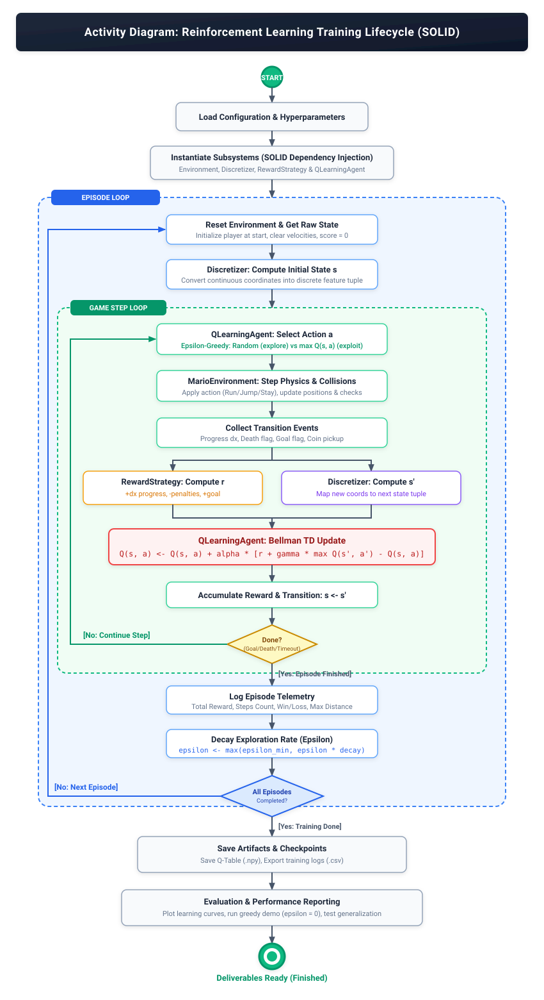

# 👻 Reinforcement Learning Game Agent: Hoá's Midnight Escape

> **Course**: Machine Learning — Project 5: Reinforcement Learning-Based Game Agent  
> **Game Concept**: **Hoá's Midnight Escape** (2D Graveyard Platformer in Pygame)  
> **Core Approach**: Tabular Q-Learning with SOLID Architecture  
> **Team Size**: 4 Members  

---

## 1. Project Overview & Problem Formulation

### 1.1 Project Objective & Story
The goal of this project is to develop an autonomous AI agent that learns to play a custom 2D platformer through **interaction and experience**, rather than manually programmed rules.

- **Story**: Hoá wakes up late on a freezing night in the middle of a graveyard near his house. Terrified and cold, he must navigate his way home—jumping over tall tombstones and open grave pits, dodging floating ghosts hovering in the air, and collecting warmth items along the way until he reaches his glowing home.
- **Learning Process**: Initially, the agent knows nothing and acts randomly. Over hundreds of episodes, it receives rewards (moving closer to home, collecting warmth items, reaching the house) and penalties (falling into grave pits, touching ghosts, stalling) to learn an optimal navigation policy.

### 1.2 Core Problem Formulation (Markov Decision Process)
- **Agent**: Hoá, observing the nearby surroundings and choosing discrete actions.
- **Environment**: A 2D midnight graveyard platformer with tall tombstones, open grave pits, hovering ghosts, warmth items, and Hoá's house as the finish line.
- **State ($S$)**: Discretized representations of Hoá's position, altitude, grounded status, and relative distance to nearby tombstones, pits, ghosts, and home.
- **Action ($A$)**: Discrete decisions (`Stay`, `Left`, `Jump`, `Right`, `Right + Jump`).
- **Reward ($R$)**: Feedback reinforcing forward progress, item collection, and reaching home while penalizing traps, ghost collisions, or stalling.
- **Algorithm**: **Tabular Q-Learning** with a Q-Table storing $Q(s, a)$ values updated via Temporal Difference (TD) learning and an $\epsilon$-greedy exploration strategy.

### 1.3 Key Deliverables
1. **Playable Game Environment**: A functional 2D Pygame platformer with keyboard controls for humans and an API for the AI.
2. **Trained AI Agent**: A Q-learning agent capable of consistently reaching the destination.
3. **Training Telemetry & Graphs**: Learning curves plotting rewards, success rates, and steps per episode.
4. **Technical Report**: Analysis comparing different reward formulations, exploration rates, and generalization across level layouts.

---

## 2. System Activity Diagram

The end-to-end lifecycle follows the standard Reinforcement Learning training and evaluation workflow:



---

## 3. Core Workflow

The system executes across 4 high-level phases during each step and episode:

1. **Environment Step**:
   - Executes the selected action (`Stay`, `Right`, `Left`, `Jump`, `Right + Jump`).
   - Updates player physics, checks bounding-box collisions, and emits game transition events.

2. **State & Reward Processing**:
   - **Discretizer**: Converts continuous coordinates and obstacle distances into a discrete state tuple $s$.
   - **Reward Strategy**: Computes scalar reward $r$ based on forward progress, death penalties, and goal bonuses.

3. **Q-Learning Update**:
   - Updates the Q-Table using the Bellman Temporal Difference equation:
     $$Q(s, a) \leftarrow Q(s, a) + \alpha [r + \gamma \max_{a'} Q(s', a') - Q(s, a)]$$
   - Decays exploration rate $\epsilon$ after each episode.

4. **Evaluation & Visualization**:
   - Runs the trained agent greedily ($\epsilon = 0$) across different level configurations.
   - Records success rates, average rewards, and plots training curves.

---

## 4. High-Level Project Structure

```text
Mario_Agent/
├── core/            # Base interfaces (Environment, Agent, Discretizer, Reward)
├── env/             # Pygame 2D graveyard environment, entities & 5 level layouts
├── discretizer/     # Continuous-to-discrete state mapping
├── rewards/         # Pluggable reward strategies (Sparse, Dense, Balanced)
├── agent/           # Q-Learning agent (Q-Table & Epsilon-Greedy policy)
├── training/        # Training pipeline & hyperparameter configuration
├── evaluation/      # Metrics logger, Matplotlib plotter, and visual playback
├── main.py          # Training entry point
└── play_human.py    # Playable game entry point (manual keyboard control)
```

---

## 5. Team Responsibilities (4 Members)

| Member | Focus Area | Primary Responsibilities |
|:---|:---|:---|
| **Member 1** | **Environment & Physics** | Pygame 2D platformer engine, jump/gravity physics, collision detection, and level layouts. |
| **Member 2** | **Agent & State Discretizer** | Q-Table implementation, Bellman TD update, continuous-to-discrete state quantizer, and $\epsilon$-greedy policy. |
| **Member 3** | **Reward & Training** | Modular reward functions, training orchestration loop, and hyperparameter tuning ($\alpha, \gamma, \epsilon$). |
| **Member 4** | **Evaluation & Report** | Metrics logging, Matplotlib learning curves, visual playback demo, and technical report. |
