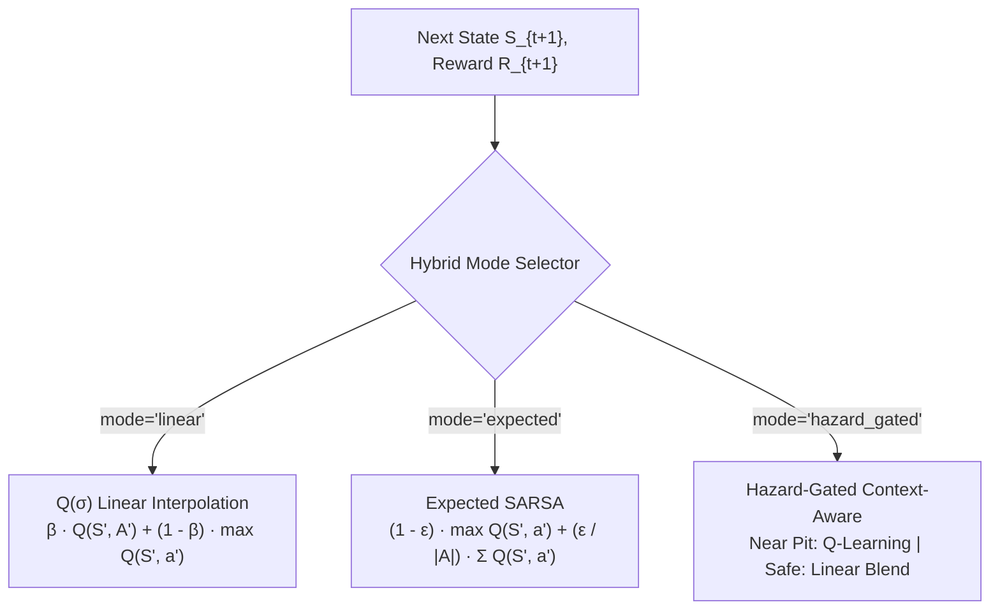

# Hybrid SARSA & Q-Learning Design: Subsystem Architecture & Theoretical Formulation

This document details the theoretical foundation, mathematical derivations, software architecture, and empirical advantages of the **Hybrid SARSA & Q-Learning Subsystem** (`agent/`) for the 2D Mario platformer environment.

---

## 1. Executive Summary & Motivation

In our 2D platformer environment (5 discrete motor actions conforming to `core.Action`), navigation imposes two conflicting demands:
1. **Fearless Precision Across Lethal Hazards:** Pits ($65\text{--}75\text{ px}$ wide) impose severe penalties ($r_{\text{pit}} = -75.0$). Clearing them requires precise execution of `Action.RIGHT_JUMP` right at the immediate ledge ($\le 32\text{ px}$).
2. **Controlled, Smooth Traversal on Flat Ground:** Blindly rushing forward often leads to obstacle collisions ($r_{\text{obstacle}} = -3.0$) and high-variance exploratory oscillations.

### Algorithmic Dilemma:
* **Pure SARSA (On-Policy) Failure Mode:** Evaluates states using actual sampled exploratory actions ($a_{t+1}$). Because $\epsilon$-greedy exploration periodically samples random actions (e.g., `STAY` or `LEFT`), SARSA penalizes the necessary action of approaching ledges because an exploratory blunder leads to death. This causes **extreme risk-aversion and ledge freezing**.
* **Pure Q-Learning (Off-Policy) Weakness:** Relies strictly on $\max_{a'} Q(s', a')$. Early in training, noise in value estimates causes **Maximization Bias (systematic overestimation)**. Moreover, ignoring exploratory behavior makes the agent **reckless**, crashing repeatedly into pipes during early training.

The **Hybrid SARSA / Q-Learning Agent** bridges this spectrum, capturing the fearless optimality of Q-Learning and the training stability/safety of SARSA.

---

## 2. Mathematical Formulations

The hybrid agent implements three distinct mathematical unification paradigms:



### 2.1 Paradigm 1: Linear Hybrid Formulation ($Q(\sigma)$ Framework)

Borrowing from the unified multi-step temporal-difference framework ($Q(\sigma)$ by Sutton & De Asis, 2017), the 1-step hybrid TD Target interpolates with a weighting parameter $\beta \in [0, 1]$:

$$\text{TD Target}_{\text{Hybrid}} = r_{t+1} + \gamma \Big[ \underbrace{\beta \cdot Q(S_{t+1}, A_{t+1})}_{\text{SARSA Component}} + \underbrace{(1 - \beta) \cdot \max_{a'} Q(S_{t+1}, a')}_{\text{Q-Learning Component}} \Big]$$

The value update follows standard stochastic approximation:

$$Q(S_t, A_t) \leftarrow Q(S_t, A_t) + \alpha \Big( \text{TD Target}_{\text{Hybrid}} - Q(S_t, A_t) \Big)$$

* **$\beta = 1.0$:** Collapses to **Pure SARSA** (On-Policy).
* **$\beta = 0.0$:** Collapses to **Pure Q-Learning** (Off-Policy).
* **$\beta = 0.25$ (Default):** Balances exploration awareness with optimal pursuit.

---

### 2.2 Paradigm 2: Expected SARSA (Expectation Hybrid)

Rather than sampling a single noisy action $A_{t+1}$ (SARSA) or solely relying on the greedy maximum (Q-Learning), **Expected SARSA** computes the exact expectation across all actions under policy $\pi$:

$$\text{TD Target}_{\text{Exp-SARSA}} = r_{t+1} + \gamma \sum_{a'} \pi(a' \mid S_{t+1}) Q(S_{t+1}, a')$$

Under an $\epsilon$-greedy policy with $|\mathcal{A}|$ discrete actions:

$$\text{TD Target}_{\text{Exp-SARSA}} = r_{t+1} + \gamma \left[ (1 - \epsilon) \max_{a'} Q(S_{t+1}, a') + \frac{\epsilon}{|\mathcal{A}|} \sum_{a' \in \mathcal{A}} Q(S_{t+1}, a') \right]$$

* **Asymptotic Property:** As exploration decays ($\epsilon \to 0$), Expected SARSA smoothly and deterministically converges to **Pure Q-Learning ($Q^*$)**, but eliminates sample variance during early training.

---

### 2.3 Paradigm 3: Context-Aware / Hazard-Gated Hybrid

In platformers, hazards are localized. We condition the algorithm choice dynamically on the state's proximity sensors (index 4 `pit_dist_bin` and index 5 `ghost_dist_bin`):

$$\text{Next-Value}(S_{t+1}) = \begin{cases} \max_{a'} Q(S_{t+1}, a'), & \text{if } (\text{pit\_dist} \ne \text{NONE}) \lor (\text{ghost\_dist} \ne \text{NONE}) \quad \text{(Lethal Zone: Q-Learning)} \\ \beta \cdot Q(S_{t+1}, A_{t+1}) + (1 - \beta) \max_{a'} Q(S_{t+1}, a'), & \text{if } (\text{pit\_dist} = \text{NONE}) \land (\text{ghost\_dist} = \text{NONE}) \quad \text{(Safe Corridor: Blend)} \end{cases}$$

---

## 3. Comparative Advantage Matrix

| Evaluation Dimension | Pure SARSA | Pure Q-Learning | Combined Hybrid / Expected SARSA |
| :--- | :--- | :--- | :--- |
| **Pit Navigation** | ❌ Fails (Paralyzed by fear of exploratory falls) | ✅ Optimal (Learns exact `RIGHT_JUMP` timing) | ✅ **Optimal** (Protected by Q-learning target) |
| **Maximization Bias** | ✅ None (No max operator) | ❌ High (Prone to overestimating noisy values) | ✅ **Significantly Reduced** (Damped by expectation) |
| **Target Variance** | ❌ High (Dependent on stochastic action roll) | ⚠️ Moderate | ✅ **Lowest** (Averages out exploratory variance) |
| **Training Safety** | ✅ Highly cautious | ❌ Reckless / frequent crashes | ✅ **Disciplined & smooth** |
| **Learned Policy Quality** | Suboptimal with exploration noise ($Q^\pi$) | Optimal ($Q^*$) | **Optimal ($Q^*$)** |

---

## 4. Software Architecture (`agent/`)

The hybrid implementation resides in the `agent/` root alongside the baseline tabular agent:

```text
agent/
├── tabular_q_agent.py          # Primary baseline Q-Learning agent
├── hybrid_q_sarsa_agent.py     # Hybrid SARSA & Q-Learning agent
└── __init__.py                 # Re-exports TabularQAgent & HybridQSARSAAgent
```

---

## 5. SOLID Principles & Architecture Review

| SOLID Principle | Implementation in `HybridQSARSAAgent` |
| :--- | :--- |
| **Single Responsibility (SRP)** | The class is solely responsible for maintaining action-value estimates $Q(s, a)$, calculating hybrid TD targets, and selecting policy actions. It deliberately excludes environment stepping, rendering, or training loop orchestration, keeping training orchestration decoupled for the training subsystem. |
| **Open/Closed (OCP)** | Open for new blending strategies (via `mode` parameters and modular `compute_td_target`) without modifying existing environment, discretizer, or reward code. |
| **Liskov Substitution (LSP)** | Fully interchangeable with `BaseAgent` and `TabularQAgent`. Implements the exact same method signatures: `select_action(state)`, `update(state, action, reward, next_state, done)`, `decay_epsilon()`, `set_mode(training)`, `save(filepath)`, `load(filepath)`, along with `load_q_table` and `save_q_table` aliases. |
| **Interface Segregation (ISP)** | Depends only on the concise contracts defined in `core/interfaces.py` (`BaseAgent`, `DiscreteState`, `Action`), without forcing callers to implement or depend on superfluous interfaces. |
| **Dependency Inversion (DIP)** | High-level evaluation suites and external harnesses depend strictly on the `BaseAgent` abstraction rather than concrete implementation details. |

---

## 6. Usage API & Integration Guide

### Instantiation
```python
from agent import HybridQSARSAAgent
# or: from agent.hybrid_q_sarsa_agent import HybridQSARSAAgent

# Initialize agent in linear blend mode
agent = HybridQSARSAAgent(
    learning_rate=0.1,
    discount_factor=0.99,
    beta=0.25,
    mode="linear",  # Options: "linear", "expected", "hazard_gated"
    epsilon=1.0,
    epsilon_decay=0.995,
)
```

### Action Selection & Policy Execution
```python
# Select action (epsilon-greedy in training mode, greedy in eval mode)
action = agent.select_action(state)
```

### TD Update Integration
The agent provides two interchangeable update interfaces:

```python
# 1. On-Policy SARSA/Hybrid signature (passing next_action):
td_error = agent.update_hybrid(
    state=state,
    action=action,
    reward=reward,
    next_state=next_state,
    next_action=next_action,
    done=done,
)

# 2. Standard BaseAgent signature (auto-samples next_action if needed):
td_error = agent.update(
    state=state,
    action=action,
    reward=reward,
    next_state=next_state,
    done=done,
)
```
